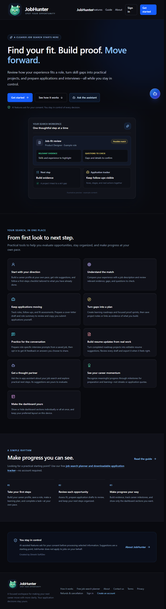
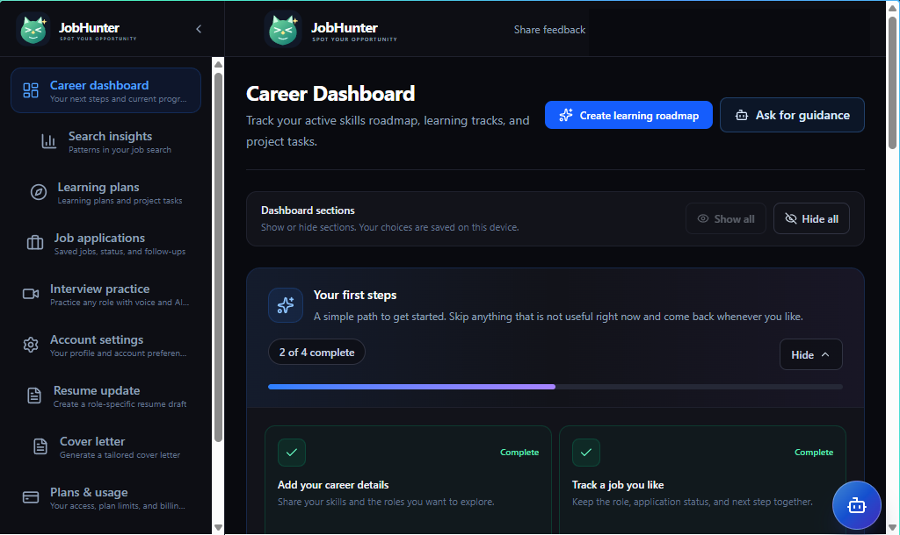
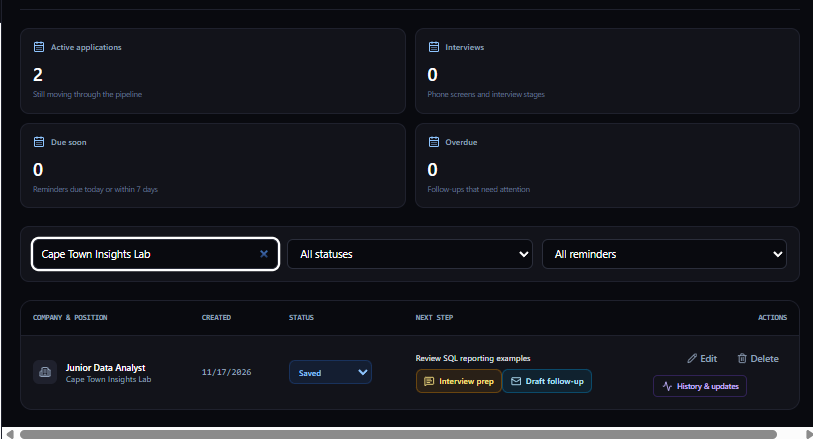

# JobHunter product showcase

## Public website capture

The image below is a full-page capture of the live public homepage. The preview inside the page is labeled as illustrative example content; it is not a screenshot of the signed-in dashboard.

- Live page: https://job-hunter-nmln.onrender.com/
- Public guide: https://job-hunter-nmln.onrender.com/guide
- Capture: real deployed homepage; no customer or account data

## Signed-in dashboard capture

The image below is a crop of the signed-in Career Dashboard screenshot shared for this showcase. The account controls containing the email address were removed from the crop.

This is a real dashboard capture, not a mockup. The visible checklist says 2 of 4 complete; no job-fit result or Applications-list screen is included in this capture.

## Applications capture

This is a real capture of the Applications page filtered to a fictional Junior Data Analyst role at Cape Town Insights Lab. That demo entry was added to the test account; the account's pre-existing application is filtered out and not shown.

## Suggested showcase sequence

Use the real homepage capture as the opener, then show the signed-in dashboard and Applications captures above. For a fuller walkthrough, record these additional screens in the deployed app with fictional data:

1. **Applications:** show one fictional saved role and its next action.
2. **Job-fit review:** show a real result for a fictional resume and job description. Include the consent step if it appears.
3. **Next step:** show a roadmap or Proof Sprint connected to a gap in that result.
4. **Control:** end on the application or dashboard view, and say that the user reviews suggestions and submits applications themselves.

Keep the captures legible on a phone. Hide browser notifications, personal tabs, account identifiers, and any real contact or payment information. Do not present example homepage content as a real user result.

## Additional capture still needed

The supplied captures do not include the result of a job-fit review. Add one using the fictional resume and job posting before describing or showing a fit result. Do not share login credentials or expose personal account data in screenshots.
